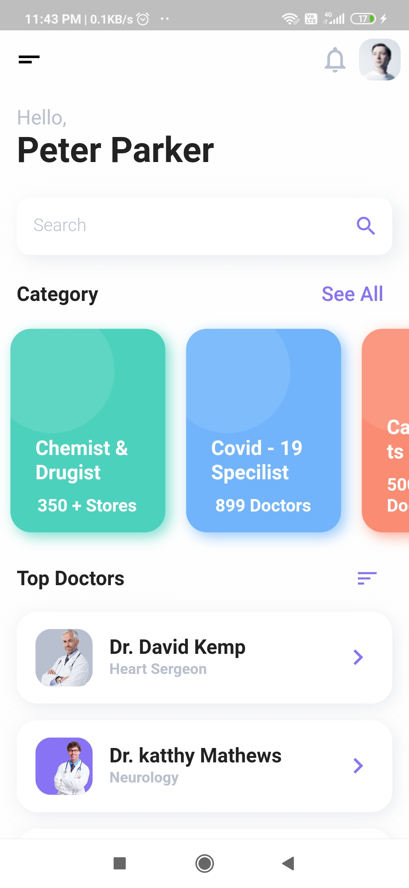
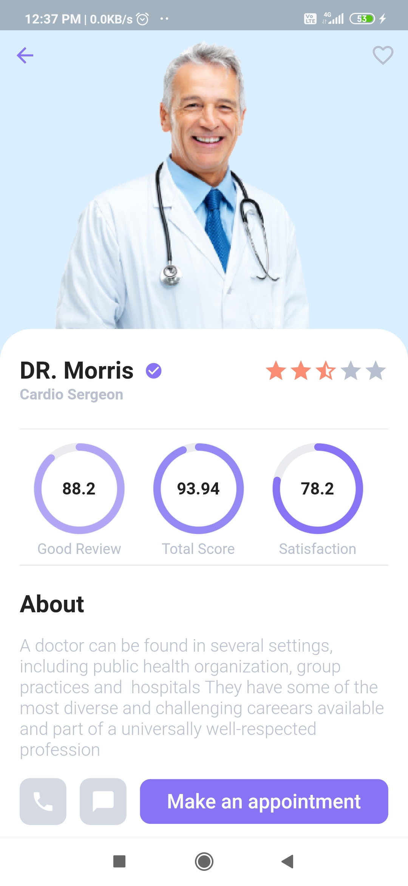
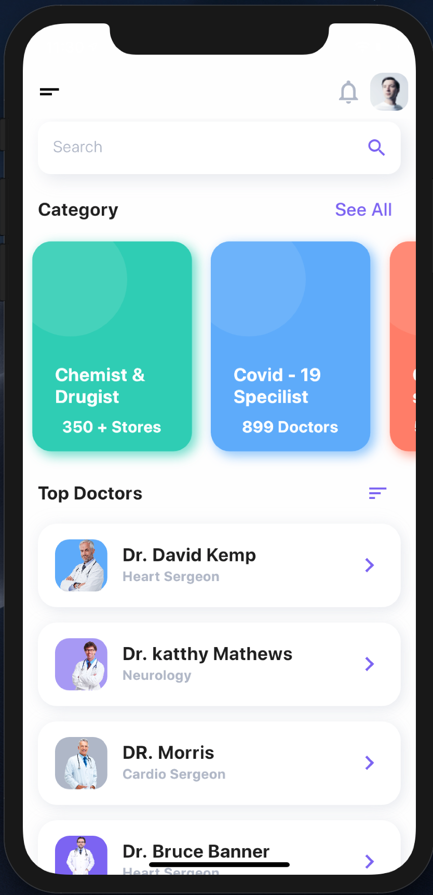
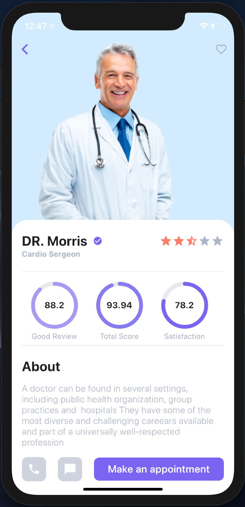

# Tele App: Doctor Appointments & Video Consultations

A Flutter telemedicine app where patients find doctors, book appointments, chat and join voice or video consultations. Calls run on ZEGOCLOUD, and accounts, profiles and push notifications run on Firebase.

<p>
  
  
  
  
</p>

## Features

- Sign up, sign in, Google Sign-In and password reset with Firebase Auth
- Doctor list, doctor details and a separate doctor dashboard
- Appointment booking with a date picker
- In-app chat between patient and doctor
- One-to-one voice and video calls with ZEGOCLOUD UIKit (call invitations via signaling plugin)
- Push notifications with Firebase Cloud Messaging and device tokens stored per user
- GetX for state management and navigation

## Tech stack

Flutter · Dart · GetX · Firebase Auth · Cloud Firestore · Firebase Messaging · Google Sign-In · ZEGOCLOUD (UIKit Prebuilt Call, Signaling, Express Engine)

## Project structure

```
lib/
  auth_ui/        welcome, sign-in, sign-up, forgot-password screens
  controllers/    GetX controllers for auth, user data and device tokens
  src/pages/      home, doctor dashboard, appointment, chat, call and video-call pages
  src/model/      user and doctor models
  src/theme/      colors, text styles and theme
  utils/          app constants and keyboard helpers
```

## Getting started

1. Install Flutter (3.x) and run `flutter pub get`.
2. Create a Firebase project and run `flutterfire configure` to generate your own `lib/firebase_options.dart`. Enable Email/Password and Google sign-in.
3. Create a ZEGOCLOUD project and put your own App ID and App Sign in `lib/utils/app-constant.dart`.
4. Run `flutter run`.

## License

Released under the [MIT License](LICENSE).
